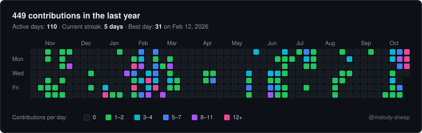

  

  
     <b>Database Developer</b>
    &nbsp;&nbsp;·&nbsp;&nbsp;
     <b>Mobile &amp; Full-Stack</b>
    &nbsp;&nbsp;·&nbsp;&nbsp;
     <b>UI/UX Design</b>
    &nbsp;&nbsp;·&nbsp;&nbsp;
     <b>Exploring AI</b>
  

 

<table>
  <tr>
    <td width="55%" valign="top">
      
        <h3>Hi, I'm melody-sheep</h3>
        

          I build apps that are simple, reliable, and easy to keep up. I start with the data,
          so the app works the way people actually do their jobs. Lately I've been learning
          <b>AI development</b> and how to add smarter features to real apps.
        

        <h4>Right now</h4>
        <ul>
          <li> Building <a href="https://github.com/melody-sheep/chemstock-app"><b>ChemStock</b></a>, a QR-based inventory app</li>
          <li> Learning Vite, shadcn/ui, FastAPI and Vercel</li>
          <li> Building with AI tools like Claude, GitHub Copilot and ChatGPT</li>
          <li> Aiming to be a database administrator and full-stack developer</li>
          <li> Open to working together on projects</li>
        </ul>
      
    </td>
    <td width="45%" valign="top" align="center">
        
      
        <h4>Let's Connect</h4>
        

          
            
          
        

      
        
      
      
    </td>
  </tr>
</table>

<h2>
  
    
    Tech Stack
  
</h2>

<table>
  <tr>
    <td width="170" valign="middle">&nbsp; <b>Languages</b></td>
    <td valign="middle"></td>
  </tr>
  <tr>
    <td valign="middle">&nbsp; <b>Front End</b></td>
    <td valign="middle">&nbsp;</td>
  </tr>
  <tr>
    <td valign="middle">&nbsp; <b>Back End</b></td>
    <td valign="middle"></td>
  </tr>
  <tr>
    <td valign="middle">&nbsp; <b>Databases</b></td>
    <td valign="middle"></td>
  </tr>
  <tr>
    <td valign="middle">&nbsp; <b>Tools</b></td>
    <td valign="middle"></td>
  </tr>
  <tr>
    <td valign="middle">&nbsp; <b>Learning</b></td>
    <td valign="middle">
       
      
      
      
      
    </td>
  </tr>
</table>

<h2>
  
    
    UI/UX Design
  
</h2>

<table>
  <tr>
    <td width="30%" align="center" valign="middle">
      
       
      
        <b>Figma</b>
         
        Where every screen starts
      
    </td>
    <td width="70%" valign="top">
      
        

          I design apps in Figma before writing any code, so the layout and flow are
          clear early and the build goes faster. I keep screens simple, consistent,
          and easy to use for the people who'll actually be using them.
        

      
      <table>
        <tr>
          <td align="center" width="25%"> <b>Research</b> Understand the users and their work</td>
          <td align="center" width="25%"> <b>Wireframe</b> Plan the layout and flow</td>
          <td align="center" width="25%"> <b>Prototype</b> Clickable screens to test</td>
          <td align="center" width="25%"> <b>Build</b> Turn designs into working apps</td>
        </tr>
      </table>
    </td>
  </tr>
</table>

<h2>
  
    
    Featured Project
  
</h2>

<table>
  <tr>
    <td width="55%" valign="top">
      
        <h3><a href="https://github.com/melody-sheep/chemstock-app">ChemStock</a></h3>
        

          An Android app that replaces paper records and tracks stock as it moves from the
          warehouse to sales reps and collectors — who handled it, where, and when.
        

        <ul>
          <li> QR code on every product batch</li>
          <li> Location saved at every handover</li>
          <li> Dated photo proof</li>
          <li> Delivery and collector tracking</li>
          <li> Alerts when stock counts don't match</li>
          <li> 4 user roles across multiple branches</li>
        </ul>
      
      

        
        
        
      

    </td>
    <td width="45%" valign="top" align="center">
       
      
        <b>BUILT WITH</b>
      
        
      
        
      
      
      
    </td>
  </tr>
</table>

<h2>
  
    
    Activity
  
</h2>

<table>
  <tr>
    <td width="50%" align="center">
      
    </td>
    <td width="50%" align="center">
      
    </td>
  </tr>
  <tr>
    <td colspan="2" align="center">
      
    </td>
  </tr>
</table>

  
  

