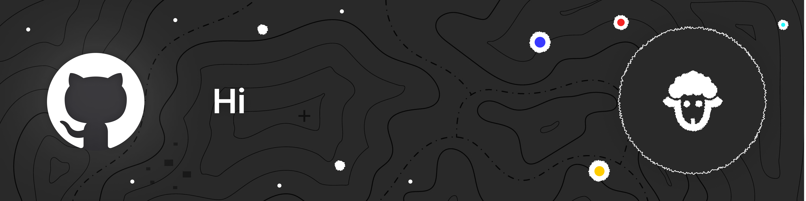

  

  

  
  
  
  

---

## 👋 About Me

I build apps that are simple, reliable, and easy to keep up. I start by getting the data right, so the app works the way people actually do their jobs. Lately I've been getting into **AI development**, learning how to add smarter features on top of good data.

<table>
  <tr>
    <td width="50%" valign="top">
      <h4>🔵 What I focus on</h4>
      Database design, mobile apps, and full-stack web apps
    </td>
    <td width="50%" valign="top">
      <h4>🟣 What I'm exploring</h4>
      AI development and how to use it in real apps
    </td>
  </tr>
  <tr>
    <td width="50%" valign="top">
      <h4>🟢 What I'm building</h4>
      ChemStock, an inventory app that tracks stock with QR codes
    </td>
    <td width="50%" valign="top">
      <h4>🟡 Where I'm headed</h4>
      Database administrator and full-stack developer
    </td>
  </tr>
</table>

---

## 🛠️ What I Do

<table>
  <tr>
    <td align="center" width="20%"><h3>🗄️</h3><b>Database Design</b> Organized, well-linked databases in PostgreSQL and Supabase</td>
    <td align="center" width="20%"><h3>📱</h3><b>Mobile Apps</b> Android apps with React Native and Expo that work offline</td>
    <td align="center" width="20%"><h3>🌐</h3><b>Full-Stack Apps</b> Express.js back ends with React and Next.js front ends</td>
    <td align="center" width="20%"><h3>🤖</h3><b>AI Development</b> Adding AI features like smart search and automation</td>
    <td align="center" width="20%"><h3>🎨</h3><b>Design to App</b> From Figma designs to working screens</td>
  </tr>
</table>

---

## 🧰 Tech Stack

#### Languages
<table>
  <tr>
    <td align="center" width="110"> <b>HTML5</b></td>
    <td align="center" width="110"> <b>CSS3</b></td>
    <td align="center" width="110"> <b>JavaScript</b></td>
    <td align="center" width="110"> <b>TypeScript</b></td>
    <td align="center" width="110"> <b>Python</b></td>
    <td align="center" width="110"> <b>Java</b></td>
    <td align="center" width="110"> <b>C</b></td>
    <td align="center" width="110"> <b>C++</b></td>
  </tr>
</table>

#### Frameworks & Libraries
<table>
  <tr>
    <td align="center" width="110"> <b>React</b></td>
    <td align="center" width="110"> <b>React Native</b></td>
    <td align="center" width="110"> <b>Expo</b></td>
    <td align="center" width="110"> <b>Next.js</b></td>
    <td align="center" width="110"> <b>Node.js</b></td>
    <td align="center" width="110"> <b>Express.js</b></td>
    <td align="center" width="110"> <b>Tailwind CSS</b></td>
  </tr>
</table>

#### Databases
<table>
  <tr>
    <td align="center" width="110"> <b>PostgreSQL</b></td>
    <td align="center" width="110"> <b>Supabase</b></td>
    <td align="center" width="110"> <b>SQLite</b></td>
    <td align="center" width="110"> <b>Firebase</b></td>
  </tr>
</table>

#### Tools
<table>
  <tr>
    <td align="center" width="110"> <b>Git</b></td>
    <td align="center" width="110"> <b>GitHub</b></td>
    <td align="center" width="110"> <b>VS Code</b></td>
    <td align="center" width="110"> <b>Figma</b></td>
    <td align="center" width="110"> <b>Android</b></td>
    <td align="center" width="110"> <b>Slack</b></td>
  </tr>
</table>

#### 📚 Currently Learning
<table>
  <tr>
    <td align="center" width="110"> <b>React Native</b></td>
    <td align="center" width="110"> <b>TypeScript</b></td>
    <td align="center" width="110"> <b>Tailwind CSS</b></td>
    <td align="center" width="110"> <b>PostgreSQL</b></td>
    <td align="center" width="110"> <b>Supabase</b></td>
    <td align="center" width="110"> <b>Express.js</b></td>
    <td align="center" width="110"> <b>AI Development</b></td>
  </tr>
</table>

---

## 🚀 Current Project: ChemStock

ChemStock replaces paper records with one Android app that tracks stock as it moves from the warehouse to sales reps and collectors — who handled it, where, and when. Test run planned for late 2026.

<table>
  <tr>
    <td align="center" width="25%"><h3>📦</h3><b>Inventory on Mobile</b> Receive, release, and return stock in one app</td>
    <td align="center" width="25%"><h3>🔳</h3><b>QR Tracking</b> Every product batch gets a QR code to scan</td>
    <td align="center" width="25%"><h3>📍</h3><b>Location Records</b> Saves the location each time stock changes hands</td>
    <td align="center" width="25%"><h3>📸</h3><b>Photo Proof</b> A dated photo at every handover</td>
  </tr>
  <tr>
    <td align="center" width="25%"><h3>🚚</h3><b>Delivery Tracking</b> Collector stops and online status</td>
    <td align="center" width="25%"><h3>🏢</h3><b>Multiple Branches</b> One manager or rep can handle several branches</td>
    <td align="center" width="25%"><h3>⚠️</h3><b>Mismatch Alerts</b> Warns when released and reported stock differ</td>
    <td align="center" width="25%"><h3>👥</h3><b>4 User Roles</b> Super Admin, Branch Manager, Sales Rep, Collector</td>
  </tr>
</table>

**Built with**

<table>
  <tr>
    <td align="center" width="110"> <b>React Native</b></td>
    <td align="center" width="110"> <b>Expo</b></td>
    <td align="center" width="110"> <b>Supabase</b></td>
    <td align="center" width="110"> <b>PostgreSQL</b></td>
    <td align="center" width="110"> <b>Express.js</b></td>
    <td align="center" width="110"> <b>Leaflet</b></td>
    <td align="center" width="110"> <b>OpenStreetMap</b></td>
    <td align="center" width="110"> <b>SQLite (soon)</b></td>
  </tr>
</table>

  

---

## 📊 GitHub Activity

<table>
  <tr>
    <td width="50%" align="center">
      
    </td>
    <td width="50%" align="center">
      
    </td>
  </tr>
  <tr>
    <td colspan="2" align="center">
      
    </td>
  </tr>
  <tr>
    <td colspan="2" align="center">
      
    </td>
  </tr>
  <tr>
    <td width="50%" align="center">
      
    </td>
    <td width="50%" align="center">
      
    </td>
  </tr>
</table>

#### 🏆 Achievements

  

---

## 📫 Get in Touch

<table>
  <tr>
    <td align="center" width="140"><a href="https://github.com/melody-sheep"> <b>GitHub</b></a></td>
    <td align="center" width="140"><a href="https://github.com/melody-sheep/chemstock-app"> <b>ChemStock Repo</b></a></td>
  </tr>
</table>

  Thanks for stopping by! 🐑

