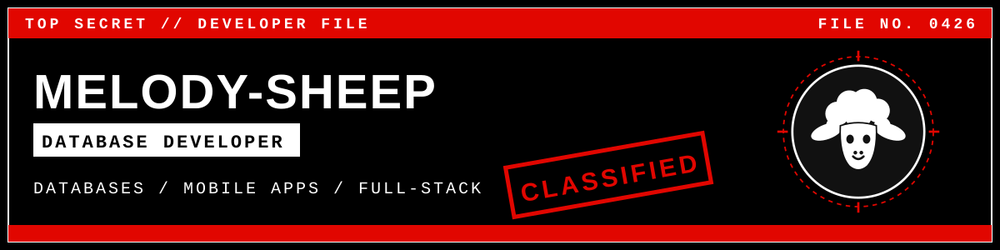

<p align="center">
  
</p>

<p align="center">
  
  
  
</p>

<p align="center">
  
</p>

<p align="center">
  
  <a href="https://github.com/melody-sheep/chemstock-app"></a>
  <a href="https://github.com/melody-sheep?tab=followers"></a>
</p>

---


```
┌──────────────────────────────────────────────────────┐
│  NAME        ████████████████  [ WITHHELD ]          │
│  ROLE        Developer focused on databases          │
│  WORKS ON    Mobile apps, full-stack apps, data      │
│  EXPLORING   AI development                          │
│  PROJECT     ChemStock – inventory app with QR codes │
│  GOAL        Database administrator and developer    │
│  STATUS      Active, open to working together        │
└──────────────────────────────────────────────────────┘
```

I build apps that are simple, reliable, and easy to keep up. I start by getting the data right, so the app works the way people actually do their jobs. Lately I've been getting into AI development, learning how to build smarter features on top of good data.

---


| Skill | What it means |
|:---|:---|
| **Database Design** | Organized, well-linked databases in PostgreSQL and Supabase that can grow |
| **Mobile Apps** | Android apps built with React Native and Expo that can also work offline |
| **Full-Stack Apps** | Back ends with Express.js connected to front ends in React and Next.js |
| **Clean Code** | Code that teammates can read, check, and build on easily |
| **AI Development** | Exploring how to add AI features to real apps, from smart search to automation |
| **Design to Finished App** | From Figma designs to working screens, tracked with Git and GitHub |

---


```
┌──────────────────────────────────────────────────────┐
│  PROJECT     ChemStock                               │
│  WHAT IT IS  Mobile inventory app using QR codes     │
│  BUILT FOR   A chemical products distributor         │
│  RUNS ON     Android                                 │
│  STATUS      Being built – test run planned late 2026│
└──────────────────────────────────────────────────────┘
```

ChemStock replaces paper records with one app that tracks stock as it moves from the warehouse to sales reps and collectors — who handled it, where, and when.

<details>
<summary><b>▶ OPEN: Main features</b></summary>
<br/>

| Feature | What it does |
|:---|:---|
| **Inventory on Mobile** | Receive, release, and return stock in one app |
| **QR Tracking** | Every product batch gets a QR code to scan |
| **Location Records** | Saves the location every time stock changes hands |
| **Photo Proof** | Takes a dated photo at every handover |
| **Delivery Tracking** | Shows collector stops and whether they're online |
| **Multiple Branches** | One manager or rep can handle more than one branch |
| **Mismatch Alerts** | Warns when released and reported stock don't match |

</details>

<details>
<summary><b>▶ OPEN: User roles</b></summary>
<br/>

| Role | What they do |
|:---|:---|
| **Super Admin** | Gives out access keys and oversees everything |
| **Branch Manager** | Handles branch stock and releases |
| **Sales Rep** | Receives and reports stock in the field |
| **Collector** | Makes deliveries and collection stops |

</details>

<details>
<summary><b>▶ OPEN: Tools used</b></summary>
<br/>

<p>
  
  
  
  
  
  
  
  
</p>

</details>

<p>
  <a href="https://github.com/melody-sheep/chemstock-app"></a>
</p>

---


**Languages**

<p>
  
  
  
  
  
  
  
  
</p>

**Frameworks**

<p>
  
  
  
  
  
  
</p>

**Databases**

<p>
  
  
  
  
</p>

**Other Tools**

<p>
  
  
  
  
  
  
</p>

---


<p>
  
  
  
  
  
  
  
  
  
</p>

---


<p align="center">
  
  
  
</p>

---


<p>
  <a href="https://github.com/melody-sheep"></a>
</p>

---

<p align="center">
  
</p>
